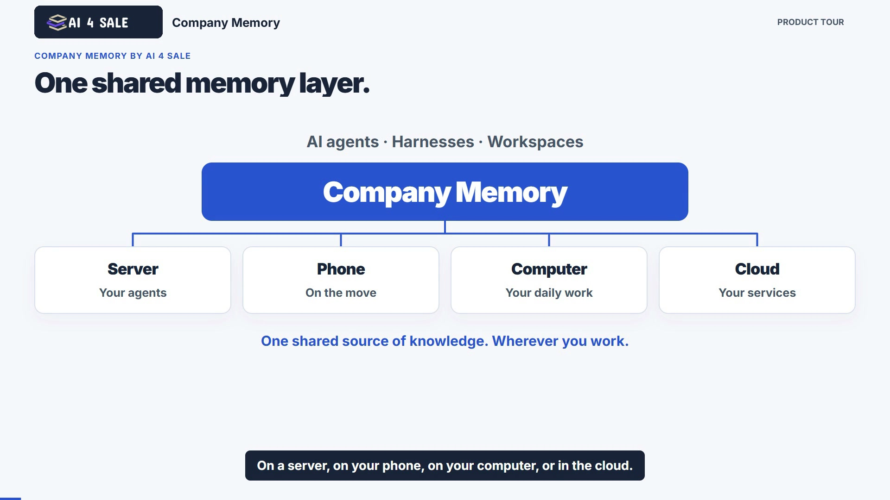
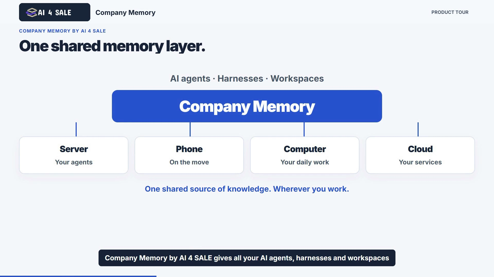
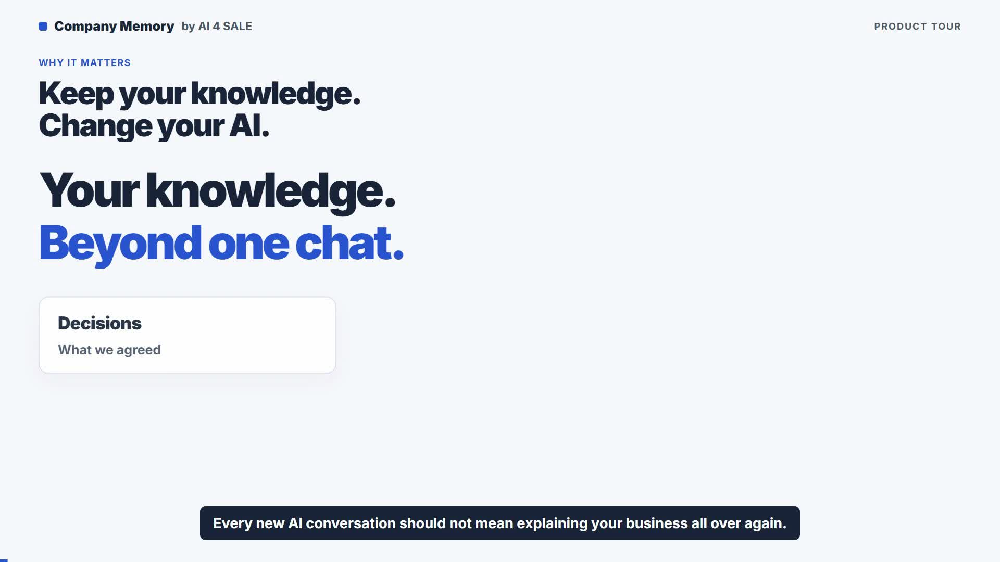
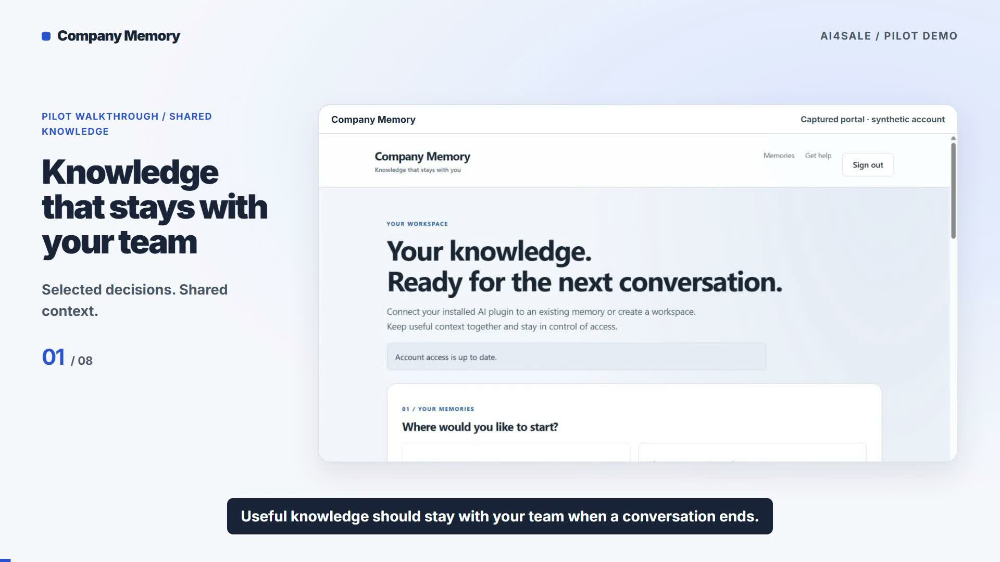

# Company Memory by AI 4 SALE

[Watch the final walkthrough](company-memory-walkthrough-20261020.mp4)
· [English captions](company-memory-walkthrough-20261020.en.srt)
· [Reviewer guide](reviewer-guide-20261020.md)
· [User guide](https://memory.ai4.sale/support/company-memory)

One shared memory layer for your AI clients. The 6:41 walkthrough follows a real
task across Codex, Codex CLI, ChatGPT and the account portal: connect, retrieve
context, do local work, invite a teammate, correct a decision, inspect/export
information, remove a disposable note and control client access.

This walkthrough uses an existing Company Memory account and a prepared demo
workspace. Account registration is not shown. Processing waits are shortened.
All eight chapters and ten functional plus four boundary scenarios are retained.
See the reviewer guide for the exact setup and evidence limits.

# Company Memory by AI 4 SALE

- 00:00:00 — Connect your shared memory
- 00:01:11 — Understand the project
- 00:01:54 — Do real work in Codex CLI
- 00:02:47 — Bring in a teammate
- 00:03:29 — Keep the decision current
- 00:04:19 — Review and share information
- 00:05:01 — Remove an old note
- 00:05:28 — Control access and continue

Duration: 00:06:40.

Video: 1920×1080, 30 fps, H.264/AAC. English narration and captions.
SHA256: `d950bf45348d107864df359e433020aed65c6237f3551eb0b0c0e3988550b116`.

## Archived review material

The following older versions are retained for traceability. Use the final
walkthrough and reviewer guide linked above for this submission.

# Company Memory by AI 4 SALE: product and review walkthrough

[Watch the complete walkthrough](company-memory-product-tour-v5.mp4) · [English captions](company-memory-product-tour-v5.en.srt) · [Exact prompts and checks](review-walkthrough.md)

One shared memory layer for your agents, harnesses and workplaces. The product
tour covers permissions, team and agent connections, shared updates and moving
between providers. The final section walks through all five functional review
cases and three no-tool cases, with exact prompts and expected outcomes.

Original AI 4 SALE logo, blue palette, fast English narration. All four connector
diagrams are repaired. Duration: 04:14.

- 00:00 Company Memory by AI 4 SALE
- 00:12 Your guided tour
- 00:26 01 / The interface
- 00:36 02 / Read and write
- 00:47 03 / Memories and zones
- 00:58 04 / Invite a colleague
- 01:07 05 / Connect a client
- 01:18 06 / Update once
- 01:28 07 / Use it everywhere
- 01:38 08 / Your knowledge travels
- 01:50 Complete guide on the website
- 02:03 Review walkthrough / Setup
- 02:16 P1 / Connection
- 02:28 P2 / Search and read
- 02:42 P3 / Submit and check status
- 02:56 P4 / Cross-conversation memory
- 03:08 P5 / Session and reconnection
- 03:23 N1 / No tool needed
- 03:34 N2 / No workspace access
- 03:46 N3 / No workspace access
- 03:58 Walkthrough complete

This is a guided explanation of how to run and check the scenarios, not a new
recording or pass report for all eight client executions.

Video SHA256: `c9cc11080a3126c555b7ba594cbd84602f47ae4ce1987efcc6032a5d2bb6ca87`.

## Previous versions

### Previous product tour

[Watch the 2:04 tour](company-memory-product-tour-v3.mp4) · [English captions](company-memory-product-tour-v3.en.srt) · [Complete guide](https://portal-stage.ai4.sale/support/company-memory)

One shared memory layer for AI agents, harnesses and workplaces across server,
phone, computer and cloud. The tour covers the interface, read-only and write
clients, memory and zone permissions, team and agent connections, and shared
project knowledge across providers.

This revision uses the original AI 4 SALE logo, preserves the blue palette,
introduces the product directly and increases narration and editing pace.
Actual portal captures are combined with workflow and device illustrations.
These illustrations do not represent additional live device acceptance tests.
Compatible client integration is required; updated facts are available on the
next permitted read after publication. The English voice is synthetic.

## Earlier versions

### Company Memory by AI 4 SALE (previous revision)

[Watch the product tour](company-memory-product-tour-v2.mp4) · [English captions](company-memory-product-tour-v2.en.srt) · [Complete user guide](https://portal-stage.ai4.sale/support/company-memory)

Keep your knowledge when you change AI providers, devices and tasks.
This 2-minute 52-second narrated tour covers the interface, read-only and write
clients, memory and zone access, team invitations, new agent connections and a
project website update shared across connected clients.

## Chapters

- 00:00 Why it matters
- 00:15 Your guided tour
- 00:31 01 / The interface
- 00:46 02 / Read and write
- 01:01 03 / Memories and zones
- 01:17 04 / Invite a colleague
- 01:30 05 / Connect a client
- 01:45 06 / Update once
- 02:00 07 / Use it everywhere
- 02:15 08 / Your knowledge travels
- 02:32 Complete guide on the website

Actual portal captures are combined with workflow and device illustrations.
The website-address example illustrates the next permitted read after publication;
it is not a new live terminal or mobile acceptance recording. Compatible client
integration is required. Narration uses a synthetic English voice.

Video: H.264, 1920×1080, 30 fps, AAC stereo 48 kHz.
SHA256: `0a92c54a3e041262c60bb0332ef5b3fa2eb76b0d33f8e2e1e0c28418dd0f4748`.

## Previous review artifacts

The older materials below are retained for traceability. The product tour above
replaces the earlier narrated presentation.

### Earlier narrated pilot demo

[Watch the narrated walkthrough](company-memory-narrated-demo.mp4) · [English subtitles](company-memory.en.srt)

The 2-minute walkthrough shows the actual portal with an isolated synthetic
account and clearly labelled summaries of recorded native MCP results. English
synthetic narration and captions explain workspace creation/joining, separate
client identities, selected publication, retrieval, access controls and revocation.

This is an edited pilot demonstration. It is not a live ChatGPT conversation,
execution of every directory review case, or evidence of public approval.
No credentials, corporate records or customer data are included.

Video: H.264, 1920×1080, 30 fps, 121.7 seconds, AAC stereo 48 kHz.
SHA256: `5195662cfeaaaad330ff797b7b761db62e3eb038061856c2f035c551d8b042db`.

## Earlier supplemental walkthrough

[Watch or download the 72-second MP4](company-memory-pilot-walkthrough.mp4).

This supplemental walkthrough combines actual portal screenshots captured on
17 October 2026 with summaries of saved MCP results from an isolated synthetic
review workspace. The native clients used Codex OAuth on a second machine.

It shows the existing workspace, accepted publication of a selected setup
note, matching retrieval by separate clients, denied operations, and selective
client revocation with writer access retained. The fictional sample project
is Aurora, its owner is Nia, and its decision is to use blue labels.

This is a narrated-by-captions evidence presentation, not a live recording of
a ChatGPT conversation. It does not establish execution of all eight directory
review cases, public approval, or completion of the paid launch. It contains
no reviewer credentials or real customer records.

File: H.264, 1280 x 720, 24 fps, 72 seconds, silent, 672328 bytes.
SHA256: `fcf6ba879dbfc94eb6e60915d2c8bd628a04e79e2a52d2c58abe639b1c05b0b9`.

The accepted synthetic source returned SHA256
`61243daaf3cc14602888fade3c74b8b058dedf5261e36b6c64b4b00ecc4d3b80`
to both clients. Following revocation the reader received HTTP 401 with 207
seconds left on its access token; the writer refreshed and retrieved the
unchanged source. Review credentials are provided only through the private
reviewer handoff, never through this repository.
